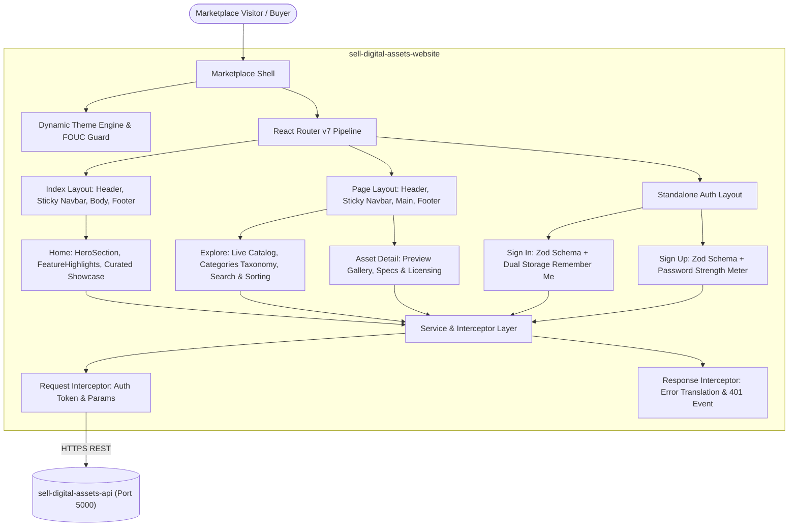
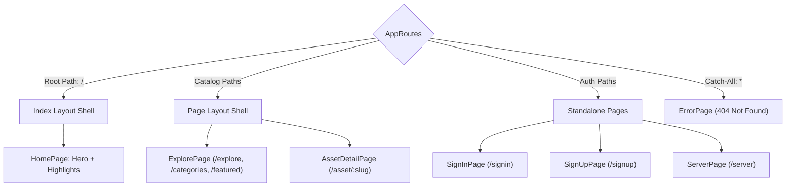
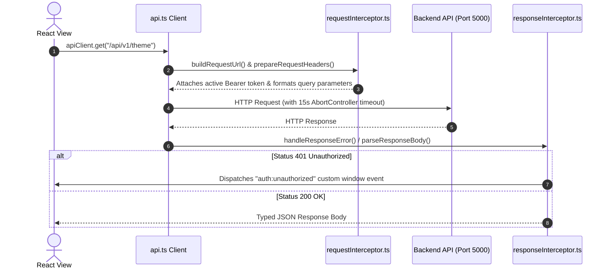

# Sell Digital Assets Marketplace — System Architecture & Technical Specifications

> **System**: Client Marketplace & Digital Asset Exploration Portal (`sell-digital-assets-website`).  
> **Tech Stack**: React 19, TypeScript 6 (Strict Mode), Vite 8, Tailwind CSS v4, React Router v7, TanStack Query v5, Zod, Sonner, Lucide React.  
> **Deployment Target**: Vercel (Edge CDN + SPA Rewrites).

---

## 1. Architectural Overview

The `sell-digital-assets-website` portal serves as the primary storefront and buyer discovery experience for the Sell Digital Assets ecosystem. Built with a modern **Single Page Application (SPA)** architecture, the application delivers sub-second navigation, dynamic theme synchronization with the backend engine, and seamless authentication.



### 1.1 Environment Isolation & Error Handling Standards
- **Localhost Development Rule**: During local development (`npm run dev`), the marketplace connects strictly to the local API server (`http://localhost:5000`) and the isolated local PostgreSQL instance. Direct connection or fallback to live production databases is strictly prohibited.
- **Human-Understandable Error Policy**: Never surface raw HTTP codes (`500 Internal Server Error`), socket errors (`ECONNREFUSED`), DNS errors (`EAI_AGAIN`), or database error details in client notifications or views.
- **Authentication Resilience**: Backend service or database connection failures are never reported as invalid credentials. If the service is unreachable during sign-in, the system communicates: `"Unable to sign in right now. Please try again later."`
- **Session Preservation**: Temporary network drops or server 5xx errors do not clear tokens from browser storage or log the user out. Session termination is reserved exclusively for verified 401 Unauthorized token revocation.

---

## 2. Client Routing & Layout Topology

All routes are declared in `src/routes/AppRoutes.tsx` with asynchronous code-splitting via `React.lazy()` and `<Suspense>`:



| Path | Layout | Description |
| :--- | :--- | :--- |
| `/` | `Index` | Homepage showcase featuring hero banner, value propositions, and curated asset highlights |
| `/explore` | `Page` | Live catalog exploration with full-text search, categories filter, and sorting |
| `/categories` | `Page` | Category-specific asset catalog view |
| `/featured` | `Page` | Curated featured digital assets showcase |
| `/asset/:slug` | `Page` | Detailed digital asset view with previews, author information, and license tiers |
| `/signin` | Standalone | Secure authentication sign-in with Remember Me preference |
| `/signup` | Standalone | User registration with real-time Zod schema validation and password strength indicator |
| `/server` | Standalone | Server maintenance and unexpected error status fallback |
| `*` | Standalone | Comprehensive 404 Not Found error layout |

---

## 3. Directory & File Organization

```text
sell-digital-assets-website/
├── public/                     # Static assets (favicons, manifest, logo.png)
├── src/
│   ├── assets/                 # Plus Jakarta Sans variable font and local graphics
│   ├── components/
│   │   ├── common/             # Shared presentation components (AssetCard.tsx)
│   │   └── ui/                 # Reusable UI primitives (Button, Card, Input, Checkbox, Badge, Modal, Skeleton, Spinner, EmptyState)
│   ├── config/                 # Environment variables (env.ts)
│   ├── context/                # Theme and Authentication context contracts
│   ├── features/               # Feature-sliced domain modules
│   │   ├── auth/               # Sign-in and sign-up mutations, Zod schemas, and types
│   │   └── website/            # Landing sections (PromoBar, HeroSection, CuratedTabs, etc.), HomePage, ExplorePage, AssetDetailPage
│   ├── hooks/                  # Custom React hooks (useAuth, useTheme, useDebounce, useLocalStorage)
│   ├── layouts/website/        # Website shell layouts (Header, Navbar, Body, Footer, Index, Page, pages/)
│   ├── lib/
│   │   ├── icons/              # Unified SVG icon library (semantic.tsx, brands.tsx)
│   │   ├── queryClient.ts      # TanStack Query client configuration
│   │   └── utils.ts            # Utility functions (cn class merger)
│   ├── provider/               # Context providers (ThemeProvider, AuthProvider)
│   ├── routes/                 # Routing pipeline (AppRoutes.tsx, ProtectedRoute.tsx)
│   ├── services/               # HTTP client & API service layer
│   │   ├── api.ts              # Centralized fetch client with AbortController timeout management
│   │   ├── queryKeys.ts        # TanStack Query cache key definitions
│   │   ├── interceptors/       # Request and response interceptor pipeline
│   │   └── v1/                 # Domain API services (assetService.ts, authService.ts, themeService.ts)
│   ├── theme/                  # Theme styles, Tailwind CSS v4 stylesheets, and tokens
│   ├── types/                  # Domain TypeScript interfaces (asset.ts, user.ts)
│   ├── utils/                  # Currency, date, and file formatting utilities
│   ├── App.tsx                 # Root application component
│   └── main.tsx                # Client application bootstrap
├── eslint.config.js            # Flat ESLint configuration with JSX A11y
├── package.json
├── tsconfig.app.json
├── vercel.json                 # Vercel deployment & SPA rewrite routing
└── vite.config.ts              # Vite bundler configuration & dev proxy (Port 5173)
```

---

## 4. HTTP Interceptor Pipeline & API Client

All network communications traverse the centralized `api.ts` client:



---

## 5. Dynamic Theme Engine & Zero-FOUC Implementation

1. **Synchronous Head Evaluation**:
   - `index.html` contains an inline JavaScript snippet that reads local storage or system preferences (`prefers-color-scheme`) and applies the `.dark` class to `<html>` prior to the initial paint.
2. **Dynamic Backend Palette Synchronization**:
   - `src/services/v1/themeService.ts` queries the backend active theme (`GET /api/v1/theme` or `/theme/theme.css`) and maps color tokens to CSS variables (`--md-sys-color-primary`, `--md-sys-color-surface`, etc.) on the `:root` element.
3. **Tailwind CSS v4 Integration**:
   - The `@theme` directive in `src/theme/styles/theme.css` maps custom properties directly to Tailwind utility classes.

---

## 6. Authentication & Session Security

1. **Dual Storage Architecture & Token Lifetimes**:
   - **Access Token Lifetime**: 15 minutes (`auth_token`).
   - **Refresh Token Lifetime**: 7 days default, 30 days when "Remember Me" is selected (`auth_refresh_token`).
   - **Idle Session Inactivity Timeout**: 30 minutes (configurable via platform system settings).
   - **Persistent Storage (`localStorage`)**: Used when the user selects "Remember Me", preserving session access across browser restarts.
   - **Ephemeral Storage (`sessionStorage`)**: Used when "Remember Me" is unselected, terminating credentials when the browser tab is closed.

2. **Concurrent Request Deduplication (In-Flight Refresh Mutex)**:
   - Token refresh operations rotate the refresh token and revoke the consumed token's `jti` in PostgreSQL.
   - To eliminate race conditions where multiple concurrent API requests encounter expired access tokens simultaneously, `authService.refreshSession()` employs a centralized in-flight mutex (`refreshPromise`).
   - All concurrent callers receive the same pending refresh promise. Only a single `/api/v1/auth/refresh` request is dispatched to the backend, preventing replay errors and unexpected session terminations.

3. **Reliable React 19 Session Hydration & Watchdog**:
   - `AuthProvider` mounts in React 19 StrictMode safely using `AbortController` cancellation rather than one-way mount flags.
   - StrictMode unmount/remount cycles reliably execute `verifySession` on the active instance.
   - A 5-second failsafe watchdog guarantees that `isLoading` is resolved to `false`, preventing endless loading states under any network condition or edge case.

4. **Expired Session Redirect & Destination Preservation**:
   - When a session genuinely expires, or when token refresh fails with an unauthorized status:
     - Storage keys (`auth_token`, `auth_refresh_token`, `auth_user`, `last_activity_timestamp`) are cleanly purged.
     - The user's intended route (e.g. `/dashboard/seller/overview`) is saved in `sessionStorage.setItem("auth_redirect_url", target)` and encoded into the query string `/?redirect=${target}`.
     - The user is redirected to the public home page (`/`) and presented with a Sonner toast: `"Your session has expired. Please sign in again."`.
     - Upon navigating to `/signin` and authenticating, `SignInPage` inspects the saved redirect target and seamlessly routes the seller back to their protected destination.

5. **Tab Visibility & Background Renewal**:
   - Tab revisit listeners (`visibilitychange` and `window.focus`) evaluate idle timeouts and re-validate or refresh the session in the background when the user returns to an inactive tab.

6. **Schema-Driven Form Validation & Toast Feedback**:
   - Sign-in and sign-up forms utilize **React Hook Form** paired with **Zod** schemas (`signInSchema.ts`, `signUpSchema.ts`).
   - All feedback follows the strict popup standard (zero inline error text); validation and operational failures are communicated exclusively via Sonner toast popups.

---

## 7. Mobile-First Responsive Design, Spacing Density & Zero-Overflow Architecture

1. **Mobile-First Layout Topology**:
   - Layouts are designed mobile-first from 320px screens upward, progressively enhancing across tablet, laptop, and ultra-wide viewports.
   - Hero headlines and marketing titles scale responsively (`text-3xl sm:text-5xl lg:text-6xl font-black`) with text balancing to prevent orphaned single-word lines.
   - Screen-spanning containers use dynamic viewport units (`dvh`, `dvw`) to avoid height jumps as browser navigation chrome collapses on scroll.

2. **Card Geometry, Sizing & Motion Restraint**:
   - Base card wrappers (`Card.tsx`) enforce targeted transitions (`transition-colors duration-150`) rather than `transition-all` to ensure zero layout shift (CLS = 0).
   - Card headers, bodies, and footers adopt standard compact mobile padding: `p-4 sm:p-6` (and `p-4 sm:p-6 pt-0`).
   - Catalog asset cards implement space-efficient density (`p-3.5 sm:p-5 space-y-3 sm:space-y-4`).
   - Modal action button rows automatically stack on mobile screens (`flex flex-col-reverse sm:flex-row items-stretch sm:items-center justify-end gap-2 sm:gap-3 p-4 sm:px-6`), with scroll containment (`overscroll-contain`) and dynamic viewport heights (`max-h-[75dvh]`).

3. **Zero Horizontal Overflow Principle**:
   - Global `overflow-x: hidden` band-aids on body elements are strictly forbidden. Layouts must never overflow horizontally.
   - All flex children and grid items specify `min-w-0` to eliminate intrinsic track expansion caused by long filenames or paths.
   - Sliding hero showcase heights scale responsively (`h-72 sm:h-96 md:h-120 lg:h-150`) to keep landing pages usable on small devices.
   - Dashboard tables and explore filters run with `overflow-x-auto w-full overscroll-x-contain`, with truncation on variable-length text strings.

---

## 8. Build & Quality Assurance Standards

```powershell
# Type checking
npx tsc -b

# Linting with JSX Accessibility rules
npm run lint

# Production build
npm run build
```

---

## 9. Seller Store Users & Team Management Architecture (RBAC)

1. **Dedicated Store Users Module**:
   - Integrated into the Seller Dashboard under `/dashboard/seller/users` (canonical) and `/seller/users` (studio layout), with backwards compatibility aliases for `/dashboard/seller/team` and `/seller/team`.
   - Feature page (`src/features/dashboard/pages/seller/SellerUsersPage.tsx`) backed by `sellerUserService.ts` and TanStack Query (`queryKeys.sellerUsers`).

2. **Dynamic PostgreSQL Database Roles**:
   - Available store roles are fetched dynamically from the database (`GET /api/v1/seller/users/roles`) filtered by `scope = 'SELLER_STORE'`.
   - Sellers can assign existing database roles to their store team members, but cannot add, edit, or delete database roles.
   - Seeded database roles:
     - `STORE_MANAGER` (ID: 4, slug: `store_manager`): Full store management access except store ownership transfer.
     - `CONTENT_UPLOADER` (ID: 5, slug: `content_uploader`): Delegated permissions to draft and upload assets.
     - `ANALYST` (ID: 6, slug: `analyst`): Read-only access to sales and analytics.

3. **Backend Multi-Tenant Isolation & Privilege Escalation Defense**:
   - Each seller can manage strictly their own store team members (`parent_seller_id = seller.id`).
   - Cross-store team member tampering or viewing is blocked at the database and service layer (returns 404/409).
   - Sellers cannot escalate permissions to platform roles (`ADMIN`, `SELLER`).
   - Existing buyer accounts without a parent seller can be onboarded to a seller's team, while existing team members cannot be poached by another store (409 Conflict).

4. **Rigorous Operational RBAC Enforcement**:
   - **Store Team Management**: Only store owners (`SELLER` or `ADMIN`) can provision, update, or remove team members (`requireStoreOwnerAccess`).
   - **Asset Mutations**: Read-only roles such as `ANALYST` are strictly forbidden from creating, updating, deleting, or uploading assets across `/api/v1/seller/assets` (`requireAssetMutationAccess`), receiving HTTP 403 Forbidden.
   - **UI & Error Reporting Standards**: Full compliance with Rule 4 (Strict Popup Notification Policy via Sonner toasts; zero inline error text) and zero layout shift skeletons.

---

## 10. Persistent Coupon & Discount System Architecture

1. **Database Schema & Entity Models**:
   - `coupons`:
     - `id`: UUID Primary Key (`gen_random_uuid()`).
     - `seller_id`: UUID Foreign Key referencing `users(id)` with `ON DELETE CASCADE`.
     - `code`: Normalized uppercase string (`VARCHAR(50)`), unique across marketplace via `CREATE UNIQUE INDEX idx_coupons_code ON coupons (UPPER(code))`.
     - `description`: Optional promotional description (`TEXT`).
     - `discount_percent`: Percentage discount integer constrained to `1% - 90%` (`CHECK (discount_percent >= 1 AND discount_percent <= 90)`).
     - `starts_at` & `ends_at`: UTC timestamps with boundary constraint `CHECK (ends_at > starts_at)`.
     - `usage_limit`: Optional positive integer (`NULL` represents unlimited redemptions).
     - `usage_count`: Integer counter incremented atomically on successful checkout redemptions.
     - `is_active`: Seller-controlled boolean activation toggle (default `TRUE`).
   - `coupon_redemptions`:
     - `id`: UUID Primary Key.
     - `coupon_id`: UUID Foreign Key referencing `coupons(id)` with `ON DELETE CASCADE`.
     - `buyer_id`: UUID Foreign Key referencing `users(id)`.
     - `order_id`: UUID with unique index `CREATE UNIQUE INDEX idx_coupon_redemptions_order_unique ON coupon_redemptions (order_id) WHERE order_id IS NOT NULL`, strictly enforcing one coupon per checkout order.
     - `discount_amount`, `currency`, `original_subtotal`, `discounted_subtotal`, `status`, `created_at`, `updated_at`.

2. **Core Business Rules & Authoritative Discount Calculation**:
   - **Seller Ownership Isolation**: Every coupon belongs exclusively to its creator (`seller_id`). A seller cannot view, modify, activate, or delete another seller's coupons.
   - **Applicable Products**: Coupons discount only paid, published assets owned by that seller. Items from other merchants in a multi-item cart are never discounted.
   - **Free Asset Exclusion**: Free assets ($0.00) are strictly ineligible for coupon discounts.
   - **Zero Client Trust**: All subtotals, eligibility, and discounts are calculated authoritatively by the backend using database asset tier pricing. Client prices or discounts are never trusted.
   - **Status Computation**: Derived dynamically from dates, activation flag, and usage count (`active`, `inactive`, `scheduled`, `expired`).

3. **Concurrency-Safe Atomic Checkout**:
   - Atomic redemption using conditional SQL:
     ```sql
     UPDATE coupons
     SET usage_count = usage_count + 1, updated_at = CURRENT_TIMESTAMP
     WHERE id = $1
       AND is_active = TRUE
       AND starts_at <= CURRENT_TIMESTAMP
       AND ends_at >= CURRENT_TIMESTAMP
       AND (usage_limit IS NULL OR usage_count < usage_limit)
     RETURNING *;
     ```
   - Two simultaneous checkouts cannot exceed the configured usage limit.
   - Failed or cancelled payments rollback consumed usage via atomic decrement.
   - Deleting a coupon with existing redemptions is prohibited to maintain audit records; sellers may deactivate it instead.

4. **REST API Contracts (`sell-digital-assets-api`)**:
   - `POST /api/v1/coupons` — Create coupon for authenticated seller (`authenticate`, `requireSellerAccess`, `requireAssetMutationAccess`).
   - `GET /api/v1/coupons` — List seller's coupons with search, status filters, sorting, and aggregate KPI metrics.
   - `GET /api/v1/coupons/:id` — Retrieve single owned coupon details.
   - `PATCH /api/v1/coupons/:id` — Update permitted coupon fields.
   - `PATCH /api/v1/coupons/:id/status` — Activate/deactivate coupon toggle.
   - `DELETE /api/v1/coupons/:id` — Delete unredeemed coupon.
   - `POST /api/v1/coupons/validate` — Validate coupon against cart items for authenticated buyers and return authoritative discounts.

5. **Seller Dashboard Coupons Module (`sell-digital-assets-website`)**:
   - Page route: `/dashboard/seller/assets/coupons`, `/seller/assets/coupons`, with aliases for `/dashboard/seller/coupons` and `/seller/coupons`.
   - Feature page: `src/features/dashboard/pages/seller/SellerCouponsPage.tsx`.
   - KPI Metrics: Total Coupons, Active Codes, Total Redemptions, Total Discount Given.
   - One-Click **"Copy Share Message"**: Generates ready-to-share promotional text with percentage, dates, and store/asset links, copying to clipboard with Sonner feedback.
   - Strict adherence to GEMINI.md: Zero inline error text (100% Sonner popup notifications), zero layout shift skeletons, mobile-first responsive cards and desktop tables.

